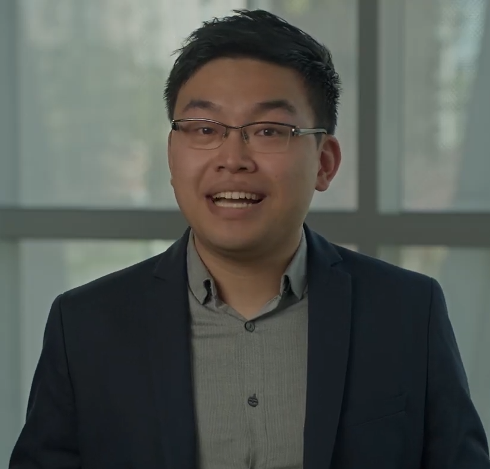

  

    
    
<i class="fa fa-envelope"></i> gromit.y.chan(at)gmail(dot)com

    
<i class="fa fa-twitter"></i> <a href="https://twitter.com/GromitC">GromitC</a> &nbsp; <i class="fa fa-graduation-cap"></i> <a href="https://scholar.google.com/citations?user=t7tR7O0AAAAJ">Google Scholar</a>

    

      
      
{{ item.date }} — {{ item.text | strip }}

      
    

  

  

    
Welcome

    
About Me:

    My name is Gromit Yeuk-Yin CHAN (陳若然), a Senior Research Scientist in Adobe Research.
     
    I received my PhD in Computer Science from New York University in 2021, advised by <a target="_blank" href="https://ctsilva.github.io/">prof. Claudio T. Silva</a> and <a target="_blank" href="https://vgc.poly.edu/~juliana/">prof. Juliana Freire</a>.
    Before that, I obtained my double degree in Computer Engineering and Business Management from HKUST in 2016.
    My research focus has been mainly in the area of Visualization, Data Management and Human Computer Interaction, including large scale data visualization, Machine Learning algorithms and Generative AI models, and creativity support tools.
    As a research scientist, I develop and transfer visualization, database, and HCI technologies to Adobe Experience Cloud.
     
     
    Here are some of the projects that keep me busy:
    <ul class="project-list">
      <li><i><strong>Generative AI Applications On Visualization/ Human Computer Interaction</strong></i>   AI Powered Graphic Content Generation and Creativity Support Tools.</li>
      <li><i><strong>Generative AI Applications On Data Management</strong></i>:   Industry Scaled Text-to-SQL Pipelines, Query Centric Machine Learning.</li>
    </ul>
    I am constantly looking for interns and collaborators to work on research projects in VIS/DB/HCI. Please send me an email to reach out and learn more.
  

